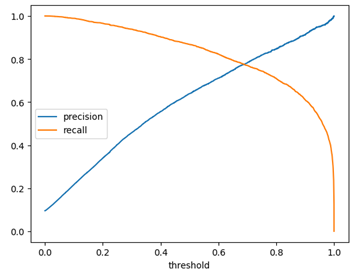
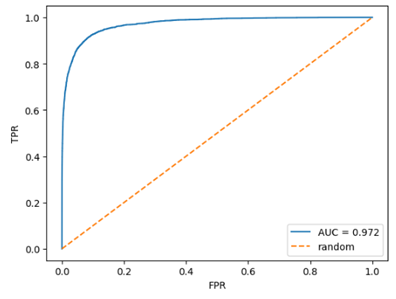
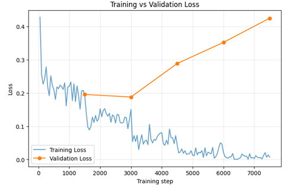
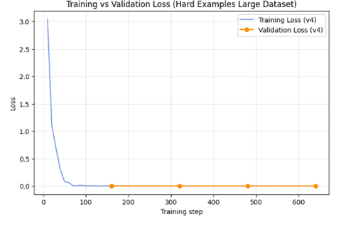

# Toxic Comments Detector

A binary text-classification project that estimates whether an English-language comment is toxic. The project explores a traditional machine-learning baseline and a transformer-based model, then tests whether additional fine-tuning on difficult examples changes model behaviour.

**Live demo:** https://toxic-comments-detector.streamlit.app/
**Colab Notebook:** https://colab.research.google.com/drive/1EAvNLMqV-nEerb5hJYaQvlTqm2YbhSK8?usp=sharing
**Hugging Face model:**  
- [DistilBERT after additional fine-tuning](https://huggingface.co/haisassan/toxic-comments-distilbert-v4)

## What the project does

The detector receives a comment and returns a toxicity prediction with a probability score. It is intended as an exploratory moderation aid: it can help flag comments for human review, but it should not make moderation decisions on its own.

The project uses the Jigsaw Toxic Comment Classification dataset and focuses on its `toxic` label as a binary target. The original dataset contains several toxicity-related labels; this project does not attempt to predict all of them separately.

## Pipeline

1. **Data preparation.** Load the Jigsaw comments, use the `toxic` column as the target, and prepare a stratified train/validation split.
2. **Baseline.** Train a TF-IDF + Logistic Regression classifier. This provides a lightweight reference point and a useful probability score for threshold selection.
3. **Transformer model.** Fine-tune `distilbert-base-uncased` for binary sequence classification on Jigsaw comments.
4. **Additional experiment.** Continue fine-tuning the transformer on a supplementary set of difficult examples. This experiment explores how the model responds to wording that can be misleading when judged by isolated keywords or surface form.
5. **Inference demo.** Make the model available through a small Streamlit application.

## Results

### Logistic Regression baseline

On the reported Jigsaw test split, the TF-IDF + Logistic Regression baseline achieved:

| Metric | Score |
|---|---:|
| Accuracy | 0.9404 |
| Precision | 0.6395 |
| Recall | 0.8679 |
| F1 | 0.7364 |
| ROC-AUC | 0.9717 |

The ROC curve indicates that the model separates the two classes well across thresholds, while the precision–recall trade-off changes substantially as the threshold moves. A threshold should therefore be selected according to the intended moderation workflow rather than assumed to be universally optimal.

**Evaluation note:** the reported threshold-tuning result was obtained by examining the same test split. It is useful as an exploratory result, but a final threshold should be selected on a separate validation set and evaluated once on an untouched test set.

### DistilBERT on Jigsaw

The training record shows that validation F1 remained close to 0.938 across five epochs. Validation loss was lowest at epoch 2 and then increased, while training loss continued to fall. This pattern is consistent with overfitting after the early epochs, even though F1 changed only slightly.

| Epoch | Training loss | Validation loss | Accuracy | F1 |
|---:|---:|---:|---:|---:|
| 1 | 0.193642 | 0.195558 | 0.936167 | 0.937713 |
| 2 | 0.150243 | 0.187844 | 0.938333 | 0.937919 |
| 3 | 0.043298 | 0.288560 | 0.938167 | 0.938156 |
| 4 | 0.021026 | 0.352112 | 0.934667 | 0.936260 |
| 5 | 0.006774 | 0.424982 | 0.936667 | 0.937335 |

### Additional fine-tuning on difficult examples

A supplementary fine-tuning experiment was run on a separate collection of difficult examples. Its reported holdout metrics were:

| Epoch | Training loss | Validation loss | Accuracy | F1 |
|---:|---:|---:|---:|---:|
| 1 | 0.001929 | 0.004243 | 0.998435 | 0.996416 |
| 2 | 0.000488 | 0.003132 | 0.998435 | 0.996416 |
| 3 | 0.000325 | 0.002521 | 0.998435 | 0.996416 |
| 4 | 0.000220 | 0.002299 | 0.998435 | 0.996416 |

These numbers describe performance on that supplementary split only. They must not be compared directly with the Jigsaw metrics as if they were measured on the same test set. The additional examples are not an independent, human-annotated benchmark; very high scores on this split do not establish real-world generalization.

### Small qualitative comparison

A small set of ten comments was run through both transformer versions. The screenshots show the prediction before and after additional fine-tuning. On this particular set, the post-fine-tuning model corrected several keyword-driven mistakes: for example, it treated profanity used in a positive sentence and the quoted word “idiot” as non-toxic. It also began flagging several direct insults and threatening language that the earlier model had marked safe.

The set also exposes remaining errors: the post-fine-tuning model marked a benign statement about disagreement as toxic, and treated a boundary-setting message (“Stop messaging me. If you continue, I'll report your account.”) as toxic. This is a small diagnostic sample, not a representative benchmark. Across all ten examples, the earlier model matches 2 of the intended labels and the post-fine-tuning model matches 8 of 10. These are descriptive counts for a hand-picked sample, not formal benchmark metrics.

## Running the demo

Open the hosted application:

https://toxic-comments-detector.streamlit.app/

Enter an English comment to receive a predicted class and toxicity probability.

## Limitations

- The task is binary and based on the Jigsaw `toxic` label; it does not capture every form of harmful or context-dependent language.
- Toxicity depends on context, intent, target, and conversation history. A single comment may not contain enough information for a reliable judgement.
- The supplementary difficult-example set has limited scope and annotation uncertainty.
- The qualitative comparison contains only ten examples and should not be treated as a formal evaluation.
- A high probability is a model score, not a guarantee that a comment is toxic.
- The detector may produce false positives for quoted language, reclaimed language, profanity used non-aggressively, or firm boundary-setting. It may also miss indirect abuse and context-dependent threats.

## Responsible use

Use the model to prioritize comments for human review, not to automatically punish users or remove content without an appeal process. Keep a human moderator in the loop, monitor false positives and false negatives, and evaluate the model on data representative of the target community and language.

## Acknowledgements

The main training data comes from the Jigsaw Toxic Comment Classification dataset.
